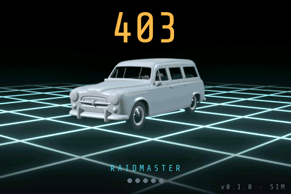

# Raidmaster 403

Tripmaster GPS de rallye-raid fait maison pour une **Peugeot 403 Familiale de 1956**, pensé pour le raid
**Crazy Dust 2027** et utilisable au quotidien en mode balade. Boîtier autonome aimanté sur la tôle du
tableau de bord : distances partielles A et B, odomètre, vitesse, cap, moyenne, chrono.

<p align="center">
  
</p>

<p align="center"><sub>Simulateur PC, échelle 1:1 de l'écran 480 × 320. GIF régénéré automatiquement à chaque build qui change l'interface.</sub></p>

## Matériel

| Élément | Choix |
|---|---|
| Carte | [Waveshare ESP32-S3-Touch-LCD-3.5B](https://www.waveshare.com/wiki/ESP32-S3-Touch-LCD-3.5B) : ESP32-S3, 8 Mo PSRAM, 16 Mo flash |
| Écran | 3,5" IPS 480 × 320, AXS15231B en QSPI, tactile capacitif intégré |
| GPS | u-blox NEO-M9N externe (UART, 10 Hz) + antenne active déportée |
| Cap | magnétomètre QMC5883L (I²C) |
| Alimentation | batterie Li-ion interne gérée par l'AXP2101, recharge USB-C, aucun fil 12 V |
| Commandes | 5 boutons (A, B, +, −, menu) + tactile |
| Boîtier | PETG / ASA imprimé, aimants au dos (pas de PLA : habitacle à 60 °C en été) |

Distance **GPS uniquement**, sans capteur de roue ni intervention sur le câblage de la voiture.

## État

| Étape | Contenu | État |
|---|---|---|
| 1 | Squelette CMake + simulateur SDL 480 × 320 | fait |
| 2 | Core portable + tests : `gps_parser` (NMEA, sur minmea), `trip_engine` (distance, moyenne, chrono, calibration), `app` (boutons, menu, sauvegarde) | fait |
| 3 | Interface LVGL câblée sur le core : raid, balade, menu réglages actif, calibration auto, démarrage animé, mode nuit | fait |
| 4 | Simulateur : rejeu de traces NMEA, trajet simulé, scénarios de bout en bout | 21 scénarios GPS en place ; boussole et matériel à venir |
| 5-6 | HAL ESP32 et firmware sur la carte | en cours : firmware de démo validé sur la carte (écran, tactile, core et UI du sim, trajet GPS simulé, NVS, heure de la RTC, état USB / batterie), jingle de démarrage par le codec ES8311 (à écouter sur la carte) ; GPS, boutons, charge de la batterie à venir |
| 7-13 | Essai en modules, carte fille 4 couches (GPS, magnétomètre), boîtier aimanté, essai raid | à faire ; carte 3.5B reçue, datasheets et modèle 3D rassemblés |

Pas encore là : boussole (le cap affiché est la route GPS), réglages de charge de la batterie (l'état
USB / batterie est lu, pas configuré), température réelle, log GPX.
Le plan détaillé et le journal des décisions sont dans [`PROMPT.md`](PROMPT.md).

## Démarrage rapide (simulateur PC)

Prérequis : CMake ≥ 3.20, Ninja, un compilateur C11, SDL2 (`sudo apt install libsdl2-dev` sous
Debian / Ubuntu / WSL). LVGL, Unity et les autres dépendances sont téléchargées par CMake ou déjà dans le
dépôt. Le code est dans `software/` : les commandes se lancent depuis ce dossier.

```bash
cd software
cmake --preset sim
cmake --build build-sim
./build-sim/raidmaster-sim                                    # trajet simulé
./build-sim/raidmaster-sim --replay trace.nmea --speed 10     # rejoue un fichier NMEA ×10
```

Le core tourne comme sur la carte : GPS fourni par le simulateur (trajet simulé ou fichier rejoué),
réglages et distances sauvegardés dans `sim-storage.json`. Au lancement, le jingle de démarrage se joue
avec l'animation par la sortie audio SDL (WSLg sous WSL) ; `SDL_AUDIODRIVER=dummy` le coupe.

| Option | Effet |
|---|---|
| `--replay fichier.nmea` | rejoue un fichier au rythme de ses horodatages (sinon trajet simulé : boucle de 2 min) |
| `--speed N` | accélère le temps GPS, 1 à 1000 |
| `--loop` | rejoue le fichier en boucle |
| `--storage f.json` / `--no-storage` | fichier de sauvegarde (défaut `./sim-storage.json`) / en mémoire |
| `--script actions.txt --out dossier` | joue des actions horodatées en temps virtuel, sans attente (tests de bout en bout) |

| Touche | Bouton / action |
|---|---|
| `a` / `b` | A / B : RAZ Trip A / Trip B ; à la calibration auto : départ et arrivée (A), annuler (B) |
| `+` / `−` | ±10 m sur le trip actif ; dans le menu : monter / descendre, ou changer la valeur en édition |
| `m` | trip actif A ↔ B ; dans le menu : choisir / valider |
| `Maj` + touche | appui long : `Maj`+`m` entre dans le menu ou en sort, `Maj`+`+`/`−` ±100 m |
| `n` ou `Tab` | bascule jour / nuit |
| `d` | coupe / rétablit le signal GPS (tunnel) |
| `p` | alimentation suivante (barre d'état) : batterie 68 %, USB en charge, USB batterie pleine, USB sans batterie, batterie 8 % |
| `v` | écran suivant (debug) |
| `Échap` | quitter (sauvegarde) |

### Tests

```bash
cd software
ctest --preset sim
tools/check.sh        # build + avertissements + tests + GIF + build firmware, résumé en 4 lignes
                      # (-c : tout recompiler, -s : sim seul)
```

- Tests unitaires du core avec [Unity](https://github.com/ThrowTheSwitch/Unity) : parseur NMEA, moteur
  de distance, application (boutons, menu, sauvegarde), synthétiseur et jingle de démarrage.
- Scénarios de bout en bout (`software/tests/fixtures/scenarios/`, 21 au catalogue) : le simulateur sans fenêtre
  rejoue une trace, appuie sur les boutons et vérifie l'état, en temps virtuel (une étape de 12 h se
  joue en moins d'une seconde, la suite entière en ~1,5 s). Les traces sont générées au build depuis
  l'itinéraire `route.txt` de chaque scénario (`software/tests/tools/gen_route.py`, Python sans dépendance).
- Les traces NMEA longues de `software/references/traces-brutes/` ne sont pas versionnées : présentes, elles sont
  rejouées (distances à ±0,1 % de la référence) ; absentes, ces tests sont ignorés.

### GIF de démo

`docs/demo/raidmaster-demo.gif` est régénéré par la cible CMake `demo_gif` à chaque build où le binaire du
simulateur change. Le simulateur tourne alors sans fenêtre, en temps virtuel, et enchaîne démarrage, raid,
balade, menu, calibration et raid de nuit. Le GIF se commite avec la modification d'interface qui l'a
produit.

- Désactiver : `cmake --preset sim -DRAIDMASTER_DEMO_GIF=OFF`.
- À la demande, agrandi ou vers un autre fichier : `software/tools/demo_gif.sh [-s 1..4] [-o sortie.gif]`.

### Animation de démarrage

La 403 fait un tour sur une grille cyan lumineuse, calé sur le jingle : elle s'élance sur les arpèges
puis ralentit en roue libre et s'arrête avec la fin de l'accord. Elle est rendue dans Blender
(`ui/assets/boot_anim/boot_anim.blend`), puis convertie au build en `boot_anim.bin` (palette 256 couleurs)
par `ui/assets/boot_anim/build_boot_anim.py`. Deux formats, mêmes pixels, à trancher : **2** par défaut
(chaque image codée par différence avec la précédente, 0,95 Mo) ou **1** (images brutes, 5,5 Mo), choisi
par l'option CMake `RAIDMASTER_BOOT_ANIM_FORMAT`. Cette conversion demande Python avec Pillow et numpy,
désigné par la variable CMake `RAIDMASTER_PYTHON`. Sans eux, l'écran de démarrage affiche une silhouette
fixe.

### Son

Le jingle de démarrage « Grille néon » (arpèges la m · fa · sol puis accord de La majeur, ~2,9 s) est
synthétisé à la volée par `core/synth.c` à partir d'une table de notes (`core/jingles.c`), en PCM 16 bits
mono à 22 050 Hz, sans fichier audio. Sortie SDL sur le sim, codec ES8311 et ampli NS4150B sur la carte
(volume dans `tools/fw.sh menuconfig`). Les propositions écartées s'écoutent sur la page
[`docs/mockups/jingles-boot.html`](docs/mockups/jingles-boot.html).

### Version

Le numéro de version est dans `software/VERSION` (seule source). L'écran de démarrage l'affiche avec la
plateforme : `v0.1.0 · SIM` sur le sim, `v0.1.0 · ESP32 · fe63e9e` sur la carte (hash git du firmware,
suivi de `*` s'il a été compilé avec des modifications non commitées). ESP-IDF reprend le même numéro.

### Polices

Tout l'affichage est en **Share Tech Mono**, compilée en polices bitmap LVGL, uniquement pour les tailles
et les glyphes utilisés. Les mêmes fichiers servent au simulateur et à l'ESP32. Régénération :
`ui/fonts/gen_fonts.sh` (demande Node.js, appelle `lv_font_conv`).

## Participer au projet : partir de zéro

Le développement se fait sur PC, sans la carte : simulateur et tests suffisent jusqu'à l'étape 5.
Testé sous Ubuntu 24.04 (natif ou WSL2). Le dépôt est privé : demander un accès au propriétaire.

1. **Outils système**

   ```bash
   sudo apt install build-essential cmake ninja-build git pkg-config libsdl2-dev python3-venv
   ```

   CMake ≥ 3.20. Sous WSL2, la fenêtre SDL s'affiche via WSLg (Windows 11).

2. **Cloner**

   ```bash
   git clone git@github.com:docteurzoidberg/raidmaster-403.git
   cd raidmaster-403
   ```

3. **Python + Pillow + numpy** (optionnel, pour l'animation de démarrage)

   ```bash
   python3 -m venv .venv
   .venv/bin/pip install pillow numpy
   ```

   CMake prend `.venv/` à la racine du dépôt (à côté de `software/`) s'il existe, sinon le `python3` du système. Pour en
   imposer un autre : `-DRAIDMASTER_PYTHON=/chemin/vers/python`. Sans Pillow ou numpy, le build passe
   quand même : le démarrage affiche une silhouette fixe.

4. **Configurer, compiler, tester, lancer**

   ```bash
   cd software
   cmake --preset sim          # télécharge LVGL et Unity au premier passage (connexion requise)
   cmake --build build-sim
   ctest --preset sim
   ./build-sim/raidmaster-sim
   ```

   Le build régénère aussi `docs/demo/raidmaster-demo.gif`. Si tu ne touches pas à l'interface et que
   `git status` le montre modifié, annule-le (`git checkout docs/demo/raidmaster-demo.gif`) ou configure
   avec `-DRAIDMASTER_DEMO_GIF=OFF`.

5. **Traces NMEA de test** (optionnel). `software/references/` n'est pas versionné. Les traces longues se
   génèrent avec les scripts Python de `software/tests/tools/` (sans dépendance, voir `software/tests/tools/README.md`),
   par exemple :

   ```bash
   mkdir -p software/references/traces-brutes
   python3 software/tests/tools/gen_nmea.py --mode linear --duration 3600 --rate 10 --speed-kmh 90 \
       --heading-deg 90 --start-lat 48.8566 --start-lon 2.3522 --start-utc 2026-10-09T06:00:00+00:00 \
       --out software/references/traces-brutes/stage_highway_1h.nmea
   ```

   Sans elles, les tests qui les rejouent sont ignorés. Si les paramètres diffèrent de ceux de
   référence, ces tests peuvent échouer sur les comptes attendus.

6. **Avant de proposer une modification**
   - Lire [`CLAUDE.md`](CLAUDE.md), [`PROMPT.md`](PROMPT.md) (état, plan, décisions) et le brief du rôle
     concerné dans [`prompts/`](prompts/). [`AGENTS.md`](AGENTS.md) dit quel rôle touche quels dossiers.
   - C11 strict, compilation sans avertissement (`-Wall -Wextra -Wpedantic`), `core/` sans aucun
     accès matériel ni LVGL.
   - Une branche par sujet, `software/tools/check.sh` propre (aucun avertissement, tests verts), GIF de démo commité avec toute modification de
     l'interface, ce README mis à jour s'il devient faux.
   - Optionnel : `compile_commands.json` est exporté dans `software/build-sim/` pour clangd ou ton IDE (lien
     symbolique à la racine si besoin).
   - Code sous GPL-3.0.

## Firmware ESP32

Projet ESP-IDF dans `software/firmware/`, construit avec **ESP-IDF v5.5.6** et les **mêmes** `core/` et
`ui/` que le simulateur (leurs `CMakeLists.txt` servent aux deux builds) ; les pilotes de la carte sont
dans `software/hal_esp32/`. Version actuelle : **démo** sans périphérique externe (trajet GPS simulé,
tactile en guise de boutons, sauvegarde en NVS, animation de démarrage en flash, jingle de démarrage par
le codec ES8311, heure de la RTC, état USB / batterie lu sur le PMIC).

```bash
cd software
tools/fw.sh build        # compile (ESP-IDF chargé par le script)
tools/fw.sh flash        # programme + animation de démarrage, puis 10 s de journal de la carte
tools/fw.sh log 20       # redémarre la carte et affiche 20 s de journal
tools/fw.sh menuconfig   # menu « Raidmaster 403 » : sens de l'écran, rétroéclairage, volume, tactile-boutons
```

Installation d'ESP-IDF, liaison de la carte à WSL (usbipd), réglages et dépannage :
[`software/firmware/README.md`](software/firmware/README.md).

## Organisation du dépôt

```
software/        tout le code ; CMakeLists.txt et CMakePresets.json, build dans software/build-sim/ ;
                 VERSION : numéro de version
  core/          logique métier en C11 portable (aucun accès matériel) : gps_parser, trip_engine, app,
                 gps_synth (trajet simulé), synth et jingles (son) ; core/include/hal/ : interfaces matériel ;
                 core/third_party/minmea
  ui/            interface LVGL v9 : écrans, thème jour / nuit, polices, images, animation de démarrage
  sim/           simulateur PC SDL2 : fenêtre, clavier, options, mode script, captures, GIF
  hal_sim/       HAL du simulateur : GPS (rejeu, trajet simulé), stockage JSON, horloge, assets, son SDL
  hal_esp32/     HAL et pilotes de la carte (écran QSPI, tactile, RTC, PMIC, son ES8311, NVS, GPS de démo…),
                 composant ESP-IDF
  firmware/      projet ESP-IDF (main/, sdkconfig.defaults, partitions.csv), build dans software/build-firmware/
  cmake/         modules CMake communs au sim et au firmware (animation de démarrage, version)
  tests/         tests unitaires Unity, scénarios (fixtures/scenarios/), tools/ : outils Python NMEA
  tools/         scripts : check.sh (vérification complète), fw.sh (firmware), demo_gif.sh
  references/    non versionné : Open Rally Computer (inspiration), traces NMEA de test
hardware/        électronique : datasheets des composants (hors git, fetch_datasheets.sh), index dans
                 README ; kicad/carte-fille/ : projet KiCad de la carte fille (en cours)
enclosure/       boîtier : modèle 3D et plan coté de la carte (cad/, hors git) ; plus tard exports
                 Fusion, 3MF
docs/            documentation
  user/          notice d'utilisation (à venir)
  demo/          GIF de démo
  mockups/       copies locales des maquettes (écrans, flèche de cap, animation et jingle de démarrage)
  roadbooks/     roadbooks de rallye-raid d'exemple (fichiers hors git, sources dans le README)
prompts/         cahier des charges découpé par rôle (features, hardware, boîtier, firmware, ui, simulation)
.claude/         skills Claude Code du projet (sim-check, firmware, ship, pcb-carte-fille)
```

Dans les briefs et le journal, les chemins de code (`core/…`, `ui/…`, `sim/…`, `tests/…`) sont
relatifs à `software/`.

## Documentation

- [`PROMPT.md`](PROMPT.md) : contexte, étapes, état et journal des décisions.
- [`prompts/`](prompts/) : un brief par rôle.
- [`AGENTS.md`](AGENTS.md) et [`CLAUDE.md`](CLAUDE.md) : organisation du travail entre agents.
- [`docs/mockups/`](docs/mockups/) : maquettes des écrans, styles de flèche de cap, propositions
  d'animation et de jingle de démarrage.

## Licence

[GPL-3.0](LICENSE).

Composants tiers :

| Composant | Licence | Usage |
|---|---|---|
| [LVGL](https://lvgl.io) v9.2.2 | MIT | interface, téléchargé au build (FetchContent pour le sim, registre ESP-IDF pour le firmware) |
| [ESP-IDF](https://github.com/espressif/esp-idf) v5.5.6 | Apache-2.0 | framework du firmware, installé à part |
| [esp_lcd_axs15231b](https://components.espressif.com/components/espressif/esp_lcd_axs15231b) 1.0.1, [esp_io_expander_tca9554](https://components.espressif.com/components/espressif/esp_io_expander_tca9554) 2.0.3 | Apache-2.0 | pilotes d'écran et d'expandeur, téléchargés au build |
| [esp_codec_dev](https://components.espressif.com/components/espressif/esp_codec_dev) 1.3.4 | Apache-2.0 | pilote du codec audio ES8311, téléchargé au build |
| Séquence d'init du panneau ([exemples Waveshare](https://github.com/waveshareteam/ESP32-S3-Touch-LCD-3.5B)) | Apache-2.0 | dans `hal_esp32/board_display.c` |
| [minmea](https://github.com/kosma/minmea) | MIT (au choix WTFPL / MIT / LGPL-3) | décodage NMEA, dans `core/third_party/minmea/` |
| [Unity](https://github.com/ThrowTheSwitch/Unity) v2.6.1 | MIT | tests, téléchargé au build |
| [Share Tech Mono](https://fonts.google.com/specimen/Share+Tech+Mono) | SIL OFL 1.1 | police, dans `ui/assets/` |
